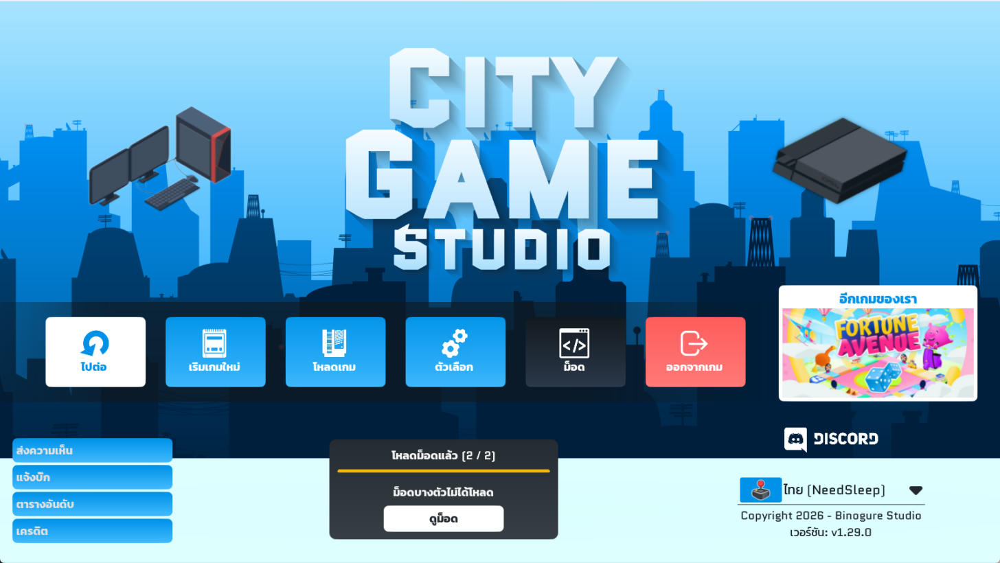

# City Game Studio — ภาษาไทย (Thai Translation)

ม็อดแปลภาษาไทยฉบับแปลใหม่ทั้งเกมสำหรับ [City Game Studio](https://store.steampowered.com/app/726840/) แปลจากต้นฉบับภาษาอังกฤษ 2,062 ข้อความ ครอบคลุมเมนู ปุ่ม คำอธิบาย บทช่วยสอน อีเวนต์ รีวิว และ achievement

> งานแปลแฟนเมด ไม่ใช่ของทางการ ไม่มีไฟล์เกมอยู่ใน repo นี้

## จุดเด่น

- **แปลใหม่ทั้งหมด** ภาษาไทยทางการในตัวเกมยังเป็นอังกฤษอยู่ราวครึ่งหนึ่ง ม็อดนี้เติมให้ครบ
- **ใช้ศัพท์ชุดเดียวทั้งเกม** คำเดียวกันบนปุ่ม ในคำอธิบาย และในบทช่วยสอน ตรงกันตาม [GLOSSARY.md](GLOSSARY.md)
- **ภาษาแบบที่เกมเมอร์ไทยใช้จริง** ปุ่มและคำอธิบายสั้น ชัด เป็นกันเอง ส่วนรีวิว ชื่อ achievement และทิปหน้าโหลดเล่นมุกตามต้นฉบับ
- **เว้นวรรคตามจังหวะประโยค** เพราะเอนจินของเกมตัดบรรทัดได้เฉพาะตรงช่องว่าง

## วิธีใช้



1. กดติดตามม็อดที่ [Steam Workshop](https://steamcommunity.com/sharedfiles/filedetails/?id=3846114491) แล้วเปิดใช้ในเมนู **Mods** ของเกม
2. ที่เมนูภาษา เลือก **ไทย (NeedSleep)**

ม็อดเพิ่มเป็นภาษาใหม่แยกจาก "ไทย" ของตัวเกม เพราะเกมไม่อนุญาตให้ม็อดทับข้อความของภาษาที่มีอยู่แล้ว

### ลงเองจากไฟล์ใน repo

เกมโหลดม็อดผ่าน Steam Workshop เท่านั้น ถ้าจะใช้ไฟล์จาก repo นี้โดยตรง ให้เปิดเกม ไปที่ **Mods → สร้างม็อดใหม่** แล้วเลือกโฟลเดอร์ `mod/` ของ repo นี้ เกมจะตรวจไฟล์และอัปโหลดเป็นไอเท็ม Workshop ของคุณเอง (ตั้งเป็นส่วนตัวได้)

## ข้อจำกัดที่รู้อยู่

- **ต้องเลือกภาษาใหม่ทุกครั้งที่เปิดเกม** เกมโหลดม็อดหลังสร้างเมนูภาษา ตอนเปิดเกมจึงยังไม่มีภาษาจากม็อดในรายการ และเกมจะเด้งไปภาษาแรกในรายการ (Deutsch) ให้เลือก **ไทย (NeedSleep)** อีกครั้งหลังขึ้นข้อความโหลดม็อดเสร็จ เป็นข้อจำกัดของตัวเกมกับภาษาที่มาจากม็อดทุกตัว
- ชื่อแบรนด์ ชื่อนิตยสาร ชื่อเครื่อง และตัวย่ออย่าง RPG/FPS คงเป็นภาษาอังกฤษตามต้นฉบับ
- ถ้าเกมอัปเดตแล้วมีข้อความใหม่ ข้อความนั้นจะแสดงเป็นภาษาอังกฤษจนกว่าม็อดจะตามทัน

## โครงสร้าง

| ที่อยู่ | คืออะไร |
|---|---|
| `mod/` | โฟลเดอร์ม็อดพร้อมใช้ (`mod.json`, คำอธิบาย, รูปพรีวิว) |
| `translation/th.json` | คำแปลทั้งหมดแบบ `คีย์: ข้อความไทย` — แก้คำแปลที่ไฟล์นี้ |
| `GLOSSARY.md` | อภิธานศัพท์และแนวทางสำนวน |
| `tools/` | สคริปต์ประกอบและตรวจม็อด |

## ร่วมแก้คำแปล

1. แก้ข้อความใน `translation/th.json` โดยคง `%s` `%d` แท็ก `[b]...[/b]` และจำนวนบรรทัดไว้เท่าต้นฉบับ
2. ประกอบม็อดใหม่

   ```
   python tools/build.py
   ```

3. (แนะนำ) ตรวจตามกฎเดียวกับตัวตรวจม็อดของเกม โดยดึงข้อความอังกฤษจากเกมที่ติดตั้งในเครื่องคุณเอง

   ```
   python tools/dump_game_strings.py "<โฟลเดอร์เกม City Game Studio>" en > english.json
   python tools/check_mod.py english.json mod/mod.json
   ```

ข้อความต้นฉบับภาษาอังกฤษดูได้ที่ repo ทางการ [city-game-studio-i18n](https://github.com/binogure-studio/city-game-studio-i18n)

## โปรเจกต์ที่เกี่ยวข้อง

- [CGS-MegaDLC-Thai](https://github.com/needsleeps/CGS-MegaDLC-Thai) — ภาษาไทยสำหรับม็อด CGS Mega DLC
- [CGS-ThirdEye](https://github.com/needsleeps/CGS-ThirdEye) — ตาทิพย์: เปิดคำใบ้ครบทุกแนวเกมตั้งแต่เริ่มเกม

## English

A complete, freshly written Thai translation mod for City Game Studio (2,062 strings). It is added as a new language, "ไทย (NeedSleep)", because the game does not let mods override strings of a built-in language. Edit `translation/th.json`, then run `python tools/build.py`.

## สัญญาอนุญาต

สคริปต์ใช้ MIT ส่วนคำแปลและเอกสารใช้ CC BY 4.0 ดู [LICENSE](LICENSE) City Game Studio เป็นลิขสิทธิ์ของ Binogure Studio

## หมายเหตุสำหรับผู้ดูแล (อัปเดต Workshop)

- อัปเดตไอเท็มผ่านเมนู **Mods → สร้างม็อด** ในเกม โดยต้อง **ปิดม็อดนี้ในเกมก่อน** แล้วเปิดเกมใหม่ ไม่อย่างนั้นเกมจะแจ้งว่า "Cannot override an already existing translations" เพราะคำแปลชุดเดิมยังโหลดอยู่
- เกมทำตัวอักษรไทยในช่องคำอธิบายเพี้ยนทุกครั้งที่โหลดไอเท็มกลับมาแก้ หลังอัปเดตผ่านเกมให้วางคำอธิบายจาก `mod/description.txt` ใหม่ที่หน้า **Edit title & description** ของ Steam
- รหัสภาษาของม็อดต้องเป็นรหัสที่เอนจินของเกมรองรับและไม่ชนกับภาษาในตัวเกม (ตอนนี้ใช้ `mt`) ถ้าใช้รหัสที่เอนจินไม่รู้จัก เกมจะวนโหลดเมนูหลักไม่จบเมื่อเลือกภาษา
